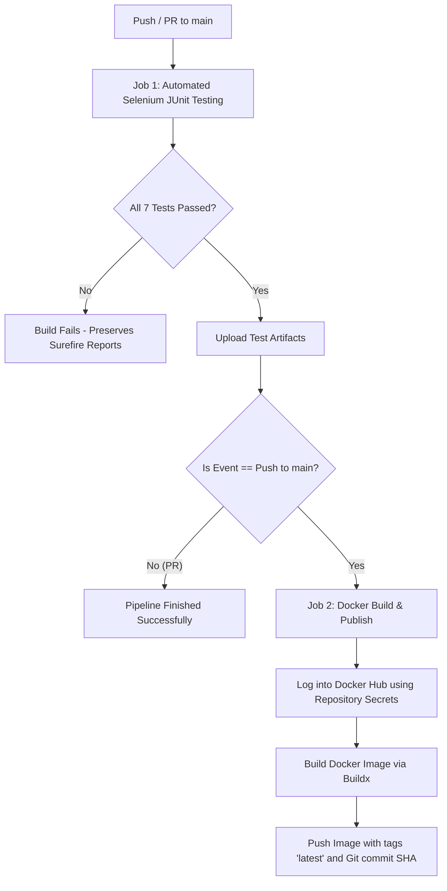

# HTML Contact Form Automation with Selenium WebDriver, Java, JUnit 5, GitHub Actions & Docker Hub


---

## 1. Experiment Title & Objective

### Title:
**Automated UI Functional and Regression Testing of an HTML Contact Form using Selenium WebDriver, Java 17, and JUnit 5 with an Automated CI/CD Containerization Pipeline on Docker Hub via GitHub Actions.**

### Objective:
1. Develop an accessible, responsive, and robust HTML5 contact form with client-side form validation using HTML, CSS, and JavaScript.
2. Automate functional testing scenarios (input validation, empty field constraints, invalid email formats, and successful submission) using **Selenium WebDriver 4** and **JUnit 5**.
3. Establish a standard **Maven** build lifecycle (`mvn clean test`, `mvn clean package`) generating deterministic Surefire XML and text execution reports.
4. Containerize the static web application into a lightweight **Nginx Alpine** Docker image.
5. Implement a continuous integration and continuous deployment (**CI/CD**) pipeline in **GitHub Actions** that automatically runs the 7 automated JUnit tests on every push and pull request, and conditionally builds and publishes the production container image to **Docker Hub** with tags `latest` and `SHA` only if all tests pass.

---

## 2. Technology Stack

| Component | Technology | Version | Purpose |
|---|---|---|---|
| **Programming Language** | Java (JDK) | 17 (LTS) | Core automation test programming language |
| **Testing Framework** | JUnit Jupiter (JUnit 5) | 5.10.2 | Test annotations, lifecycle management, assertions |
| **Automation Tool** | Selenium WebDriver | 4.25.0 | Browser automation and DOM element interaction |
| **Build Tool** | Apache Maven | 3.9+ | Dependency resolution, compilation, and test execution |
| **Frontend Application** | HTML5 / CSS3 / JavaScript | Modern ES6 | Responsive Contact Form with application-level validation |
| **Web Server / Base Image** | Nginx | Alpine (latest) | Ultra-lightweight containerized web server |
| **Container Engine** | Docker | 20+ / Buildx | Application containerization |
| **CI/CD Platform** | GitHub Actions | Workflows v4/v6 | Automated test execution and Docker deployment |
| **Container Registry** | Docker Hub | Cloud Registry | Remote storage for container images (`latest` & commit SHA) |

---

## 3. Project Directory Structure

```text
selenium-contact-form-automation/
├── .github/
│   └── workflows/
│       └── ci-cd.yml             # GitHub Actions CI/CD workflow definition
├── src/
│   └── test/
│       └── java/
│           └── com/
│               └── example/
│                   └── ContactFormTest.java  # Selenium WebDriver JUnit 5 test suite
├── webpage/
│   ├── index.html                # Responsive Contact Form HTML structure
│   ├── style.css                 # Modern CSS styles and responsive layout
│   └── script.js                 # Validation logic and submission simulation
├── pom.xml                       # Maven POM configuring Java 17, Selenium & JUnit 5
├── Dockerfile                    # Multi-platform Nginx Alpine production image recipe
├── .dockerignore                 # Files excluded from Docker image build context
├── .gitignore                    # Artifacts excluded from Git source tracking
└── README.md                     # Comprehensive project documentation
```

---

## 4. Contact Form Application Features

- **Field Specification**:
  - `Name`: Text input (`#name`), required.
  - `Email`: Email input (`#email`), required, validated against RFC 5322 regex.
  - `Message`: Multiline textarea (`#message`), required.
  - `Submit`: Primary action button (`#submitBtn`).
- **Application-Level Deterministic Validation**:
  - Browser-native HTML validation popups differ across browsers (Chrome, Firefox, Safari) and OS environments. To ensure consistent testability, native popups are disabled via `novalidate`, and deterministic application-level error elements (`#nameError`, `#emailError`, `#messageError`) are used.
- **Local Demonstration Submission**:
  - Prevents accidental network dispatch via `event.preventDefault()`.
  - When valid, displays `#successMessage`: `"Your message has been submitted successfully!"`.
  - Dynamically clears errors when inputs are modified.

---

## 5. Automated Selenium & JUnit 5 Test Suite

All automated tests are implemented in `src/test/java/com/example/ContactFormTest.java` using JUnit 5 `@Test` and `@DisplayName` annotations, with `@BeforeEach` and `@AfterEach` lifecycle fixtures:

| Test Case | Method Name | Description & Verification |
|---|---|---|
| **Test Case 1** | `testContactFormDisplay()` | Verifies that the page title contains "Contact Form" and that Name, Email, Message, and the Submit button are visible in the DOM. |
| **Test Case 2** | `testSuccessfulFormSubmission()` | Fills valid values for Name, Email, and Message, clicks Submit, and asserts that `#successMessage` displays `"Your message has been submitted successfully!"`. |
| **Test Case 3** | `testEmptyFormValidation()` | Clicks Submit on an empty form. Asserts that the form does NOT submit and that validation messages appear for Name (`"Name is required."`), Email (`"Email is required."`), and Message (`"Message is required."`). |
| **Test Case 4** | `testEmptyNameValidation()` | Fills valid Email and Message but leaves Name empty. Asserts no success message and verifies `"Name is required."`. |
| **Test Case 5** | `testEmptyEmailValidation()` | Fills valid Name and Message but leaves Email empty. Asserts no success message and verifies `"Email is required."`. |
| **Test Case 6** | `testEmptyMessageValidation()` | Fills valid Name and Email but leaves Message empty. Asserts no success message and verifies `"Message is required."`. |
| **Test Case 7** | `testInvalidEmailValidation()` | Fills valid Name, valid Message, but an invalid email format (`not-a-valid-email-format`). Asserts that `"Please enter a valid email address."` is displayed. |

### Explicit Waits vs. Sleeps
The test suite utilizes `WebDriverWait` and `ExpectedConditions.visibilityOfElementLocated` rather than hardcoded `Thread.sleep()` intervals, ensuring fast, stable, and deterministic executions in both local environments and headless CI containers.

---

## 6. Local Execution Guide

### Prerequisites
1. **JDK 17** installed and configured in `JAVA_HOME`.
2. **Apache Maven 3.9+** available on system `PATH`.
3. **Google Chrome** browser installed.

### Execute Tests via Maven
```bash
# Navigate to the project directory
cd selenium-contact-form-automation

# Execute the Selenium JUnit 5 tests
mvn clean test
```

### Build the Package
```bash
mvn clean package
```

Test reports are generated in `target/surefire-reports/`.

---

## 7. Docker Containerization

The contact form is served using a lightweight, hardened **Nginx Alpine** container.

### Build Docker Image Locally
```bash
docker build -t selenium-contact-form-automation:latest .
```

### Run Docker Container
```bash
docker run -d --name contact-form-app -p 8080:80 selenium-contact-form-automation:latest
```

### Access Application
Open your web browser and navigate to:
```text
http://localhost:8080
```

To stop and remove the container:
```bash
docker stop contact-form-app
docker rm contact-form-app
```

---

## 8. GitHub Actions CI/CD Pipeline

The pipeline `.github/workflows/ci-cd.yml` automates the quality gate and deployment:



### Secrets Configured in GitHub Repository:
- `DOCKERHUB_USERNAME`: Docker Hub user handle.
- `DOCKERHUB_TOKEN`: Secure Docker Hub Personal Access Token (Read/Write).

---

## 9. Docker Hub Repository & Published Images

- **Docker Hub Repository**: `<dockerhub-username>/selenium-contact-form-automation`
- **Published Tags**:
  - `latest` : Points to the most recently verified build on the `main` branch.
  - `<commit-sha>` : Immutable tag corresponding to the specific Git commit SHA.
